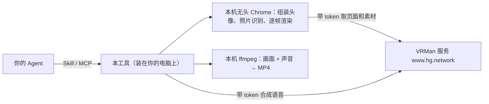

# VRMan Skill · 数字人工具

让 Agent（Claude Code、Claude Desktop、Cursor 等）直接帮你做两件事：

- **描述或照片 → 3D 头像**：「做一个栗色长卷发、戴圆框眼镜的女生头像」，得到一个能说话、会眨眼的 GLB 模型和一张预览图。
- **文本 + 照片或头像 → 说话视频**：「让这张照片说『欢迎来到发布会』」，得到一个对好口型的 MP4。

装好后，在 Agent 里这样说就行：

> 用我这张照片（是我本人）做一个 3D 头像，再让它说「大家好，我是小王」，视频存到桌面。

## 工作方式



- **照片只在你的电脑上处理**，不会上传。发到服务器的只有要念的文字。
- 素材和语音合成来自 VRMan 服务，要用 www.hg.network 的账号登录（注册免费，所有账号都能用）。
- 第一次运行要下载素材（精细头模两百多 MB，要等几分钟），之后有本机缓存，只确认有没有更新。

## 安装

**1. 准备环境**：Python 3.10+、Chrome（或 Playwright 自带的 Chromium）、ffmpeg。

```bash
git clone https://github.com/hypergraphdev/vrman-skill.git ~/vrman-skill
```

```bash
pip3 install -r ~/vrman-skill/requirements.txt
```

没装 Chrome 时运行下面这条：

```bash
python3 -m playwright install chromium
```

ffmpeg：Mac 上用 `brew install ffmpeg` 安装，Ubuntu 上用 `sudo apt install ffmpeg` 安装。

**2. 登录（每台电脑一次）**：输入 www.hg.network 的账号和密码，换一个 token 存到 `~/.config/vrman/token`（只有你自己能读）。
密码只发给 hg.network 的登录接口，不会保存。

```bash
python3 ~/vrman-skill/vrman.py login
```

用下面这条确认登录成功，也能看到用量：

```bash
python3 ~/vrman-skill/vrman.py whoami
```

**3. 接到你的 Agent**（选一种）：

### Claude Code

装成插件，Skill 和 MCP 工具一起装好：

```bash
claude plugin marketplace add hypergraphdev/vrman-skill
```

```bash
claude plugin install vrman@vrman-skill
```

也可以在 Claude Code 里输入 `/plugin marketplace add hypergraphdev/vrman-skill`，再输入 `/plugin install vrman@vrman-skill`。装完重开会话生效。

### Claude Desktop

打开「设置 → 开发者 → 编辑配置」，在 `claude_desktop_config.json` 里加上下面这段，然后重启 Claude Desktop：

```json
{
  "mcpServers": {
    "vrman": {
      "command": "python3",
      "args": ["/Users/你的用户名/vrman-skill/mcp_server.py"]
    }
  }
}
```

路径要写完整，不能用 `~`。如果提示找不到 `mcp` 模块，把 `python3` 换成装过依赖的那个 Python 的完整路径（用 `which python3` 查）。

### Cursor 及其他支持 MCP 的工具

配置写法相同。Cursor 的配置文件是 `~/.cursor/mcp.json`。

### claude.ai 网页版

暂不支持。网页版的 Skill 跑在云端沙箱里，开不了浏览器，也连不上你本机的工具。

## MCP 工具

| 工具 | 做什么 |
|---|---|
| `tag_vocabulary` / `search_assets` | 各部位能用的标签词和调色板；按标签搜素材 |
| `list_voices` | 可用的发音人（目前开放微软的免费发音人） |
| `create_avatar_from_description` | 清单 → GLB，附一张头肩预览图，Agent 能直接看到效果 |
| `create_avatar_from_photo` | 照片 → GLB（生成相似形象 / 照片直出），附预览图 |
| `render_talking_video` | 文本 → MP4，说话的可以是照片、GLB 头像或现组装的头像；`style` 选口型方式（见下） |

**素材库**：只有一个统一素材库（`refined-current`），不用选。它有精细头模、细丝头发、亚洲发型和五官、
能精调的五官（清单里写 `morphs`），还有手表、手机、皮肤细节。
以前的版本名（命令行 `--library`、MCP 的 `library` 写 `original`、`refined-v2` 等）还认，旧命令照样能跑。

**口型方式**（命令行 `--style`、MCP 的 `style`）：

| 值 | 名字 | 特点 |
|---|---|---|
| `default` | 默认 | 复韵母在一个字里滑过去（好 = a→o） |
| `simple` | 优化精简 | 每个字一个口型，靠字与字之间的过渡 |
| `talkinghead` | TalkingHead | 相邻口型叠加过渡 |
| `natural` | 真人平滑 | 嘴唇只在 b/p/m/f 时合拢，下巴按声母抬落：不会一直张着，也不会每个字都抖 |

不指定输出路径时，结果写到 `~/vrman-output/`。

## 命令行

```bash
python3 ~/vrman-skill/vrman.py avatar --spec '{"gender":"female","hair":"long wavy","hair_color":"栗色","glasses":"round"}' --out a.glb --preview a.png
```

```bash
python3 ~/vrman-skill/vrman.py talk --text "大家好" --avatar a.glb --out hello.mp4
```

```bash
python3 ~/vrman-skill/vrman.py avatar --spec '{"gender":"male","hair":"v4-hair-03","morphs":{"v3_eye_spacing":0.3}}' --out m.glb --preview m.png
```

还有 `tags`、`assets`、`voices`、`login`、`whoami` 几个命令，`--help` 可以看全部参数。
头像清单的写法见 [skills/vrman/SKILL.md](skills/vrman/SKILL.md)。

## 使用规则

- 用照片生成头像或视频，必须是**本人照片或已获本人授权**（命令行加 `--consent`，MCP 传 `consent=true`），否则直接报错。
- 视频右下角默认带「AI 生成」角标。对外发布时请保留，或用其他方式标明是 AI 生成的。

## 常见问题

| 现象 | 处理 |
|---|---|
| `token 无效或还没登录` | 运行 `vrman.py login` |
| `还没开通 VRMan Agent` | 账号被管理员停用了，请联系管理员 |
| `统一素材库现在用不了` | 服务上的模型文件出了问题，稍后再试或联系管理员 |
| 找不到 Chrome | 运行 `python3 -m playwright install chromium` |
| `需要 ffmpeg 合成视频` | 安装 ffmpeg |
| 第一次很慢 | 在下载素材，第二次起会快很多 |

## 许可

代码采用 MIT 许可证。3D 素材和页面属于 VRMan 服务，只能通过服务使用。
