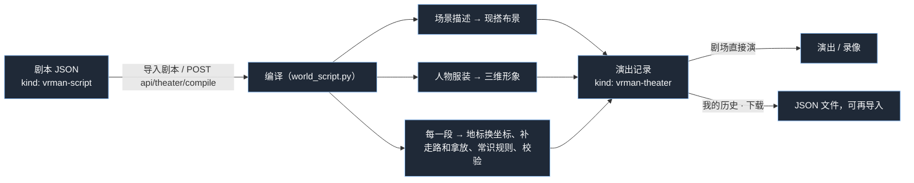

# 剧本 JSON 规范（vrman-script v1）

人或 AI 照这份规范写的剧本，在剧场里「导入剧本」就能直接演。程序把剧本编译成演出记录后，一段一段地演。
样板：`data/world/scripts/wusong-tavern.json`（景阳冈·三碗不过冈，两段）。



## 一、两种 JSON

| kind | 谁写 | 写什么 | 怎么用 |
|---|---|---|---|
| `vrman-script` | 人、AI | 地标（table、counter.front、near:wusong）、家具名、整段的动作（坐下、上菜、打斗）；场景写成一段描述 | 导入后先编译，再演 |
| `vrman-theater` | 程序 | 编译好的坐标、时长、每一步，可以直接演 | 导入直接演；「我的历史」里每一场都能下载成这种 |

写剧本只写 `vrman-script`。编译出错时，错误信息会写清楚是第几段、第几步、哪里不对。

## 二、最小的例子

```json
{
 "kind": "vrman-script", "version": 1, "title": "小酒店", "era": "宋",
 "cast": [
  {"id": "ke", "name": "客人", "sex": "male", "age": "adult", "tag": "赶路的客商", "voice": "zh-CN-YunjianNeural"},
  {"id": "dian", "name": "店家", "sex": "male", "age": "elder", "voice": "zh-CN-YunyangNeural", "costume": {"hair_color": "银灰"}}
 ],
 "places": [
  {"id": "inn", "name": "路边酒店", "scene": {
    "look": "黄昏的乡村小酒店，正中一张八仙桌两条长凳，后墙边一张高桌当柜台",
    "kind": "indoor", "ground": "wood",
    "seating": {"style": "对坐", "table": "g-furniture-square-table", "seat": "g-furniture-long-bench", "name": "table"},
    "things": [
     {"name": "counter", "id": "g-furniture-song-table", "what": "柜台", "where": "back"},
     {"name": "bowl", "id": "g-wuxia-wine-bowl", "what": "酒碗", "on": "counter"},
     {"name": "jug", "id": "a-story-v1-wine-jug", "what": "酒壶", "on": "counter"}
    ]}}
 ],
 "segments": [
  {"place": "inn", "summary": "客人进店坐下，店家上碗筛酒",
   "cast": [{"id": "ke", "position": "front"}, {"id": "dian", "position": "counter.front"}],
   "steps": [
    {"action": "enter", "actor": "ke", "from": "front"},
    {"action": "sit", "actor": "ke", "seat": "table-right"},
    {"action": "say", "actor": "ke", "to": "dian", "text": "店家，打酒来！", "delivery": "大喊"},
    {"action": "grasp", "actor": "dian", "entity": "bowl"},
    {"action": "release", "actor": "dian", "entity": "bowl", "onto": "table", "for": "ke"},
    {"action": "grasp", "actor": "dian", "entity": "jug"},
    {"action": "parallel", "actions": [
     {"action": "hold", "actor": "dian", "entity": "jug", "to": "over:bowl", "duration": 1.4},
     {"action": "animate", "entity": "bowl", "clip": "fill-empty", "duration": 1.4}]},
    {"action": "grasp", "actor": "ke", "entity": "bowl"},
    {"action": "hold", "actor": "ke", "entity": "bowl", "to": [-0.1, 1.22, 0.18], "duration": 1.5},
    {"action": "release", "actor": "ke", "entity": "bowl"}
   ]}
 ]
}
```

步骤可以不写 `id`、`next`，程序会按顺序编号、连起来，最后补一个 `cut`。

## 三、顶层

| 字段 | 必填 | 说明 |
|---|---|---|
| `kind` | 是 | 固定写 `"vrman-script"` |
| `version` | 是 | `1` |
| `title` | 是 | 剧名 |
| `era` | 是 | `先秦` `秦汉` `魏晋` `隋唐` `宋` `元` `明` `清` `现代` `奇幻` 之一：定服装、道具的朝代 |
| `cast` | 是 | 人物表，最多 12 位（同台最多 4 位） |
| `places` | 是 | 地点表：每个地点一段场景描述，程序现搭布景 |
| `segments` | 是 | 一段一段的戏，1～30 段 |

## 四、人物 `cast[]`

| 字段 | 说明 |
|---|---|
| `id` | 英文短名（字母开头，最长 32 位），步骤里用它 |
| `name` | 中文名，字幕上显示 |
| `sex` | `male` / `female` |
| `age` | `child` / `adult` / `elder` |
| `tag`、`rank` | 身份（「打虎好汉」「冈下酒店掌柜」）、阶层（「江湖」「平民」「官员」）：古装戏按身份和朝代配衣服、冠帽 |
| `looks` | 外貌描述（给人看的） |
| `voice` | 嗓音 id，见 `data/world/voices.json`。中文常用：`zh-CN-YunjianNeural` 云健（浑厚男声）、`zh-CN-YunyangNeural` 云扬（沉稳男声）、`zh-CN-YunxiNeural` 云希（青年男声）、`zh-CN-XiaoxiaoNeural` 晓晓（女声）、`zh-CN-XiaoyiNeural` 晓伊（少女） |
| `rate`、`pitch` | 这个人说话的语速（-30～30）、音高（-20～20） |
| `costume` | 形象，见下面 |

`costume` 字段：

- 古装戏的成人、老人：衣服冠帽由程序按朝代和身份配，只写这几项：`hair_color`（`黑色` `深棕` `棕色` `栗色` `金色` `亚麻` `红棕` `银灰`）、`skin`（`瓷白` `象牙` `自然` `小麦` `蜜色` `古铜` `棕褐` `深棕`）、`beard`（`goatee`、`short_full` 这类标签，或 `none`）、`headwear: "none"`（不要帽子）。
- 现代戏的成人：`hair`、`outfit`、`shirt`、`beard`、`glasses`、`headwear`、`eyebrow` 写英文标签词，例如 `"outfit": "formal business suit"`，不要的写 `none`。
- 儿童：`preset` 写儿童角色 id。

库里没有合适的服装时，编译结果的 `gaps` 会列出来（例如「劲装（江湖，宋）」），照样能演。

## 五、地点 `places[]`

```json
{"id": "inn", "name": "景阳冈下酒店", "scene": { … }}
```

`scene` 是一段场景描述，程序照它从道具库里挑东西现搭，中间留空给人演戏：

| 字段 | 说明 |
|---|---|
| `look` | 一句话描述（120 字以内） |
| `kind` | `indoor`（有墙的屋子，前面敞开对着观众）/ `outdoor` |
| `ground` | `wood` `stone` `paving` `dirt` `grass` `sand` `snow` |
| `sky` | `clear` `overcast` `dawn` `dusk` `night`（室外） |
| `weather` | `none` `snow` `rain` `fog` |
| `walls`、`floor` | 室内墙、地板颜色，例如 `"#cdbb98"` |
| `seating` | 桌子和座位，见下面 |
| `things` | 其他东西，最多 6 种，每种最多 6 件 |

`seating`：

- `style`：`对坐`（桌子左右各一个座位）、`主客`（后面一个主位，左右各一个客位）、`围坐`；
- `table`、`seat`：道具 id；
- `name`：桌子叫什么，默认 `table`。座位叫 `table-left`、`table-right`、`table-behind`。

`things[]` 每一项：

| 字段 | 说明 |
|---|---|
| `what` | 中文名（没写 `id` 时按它在道具库里找） |
| `id` | 道具 id（`data/props.json`），写了就用这件 |
| `name` | 起个名字（英文短名）：家具名当地标用（`counter`、`counter.front`）；放在家具上的小东西，名字就是演出时的道具 id（`bowl`）。几件的自动加 `-1`、`-2` |
| `count` | 几件，默认 1 |
| `where` | `back` 后墙边、`left`、`right`、`around` 四周、`far` 远处 |
| `on` | 放在哪件家具上（写那件家具的 `name`）：酒碗在柜台上、书在案上。放在家具上的小东西演出时能拿起来 |
| `color` | 换个颜色 |

注意：

- 站着的人能拿到的台面要有 0.65 米以上高。矮几、矮柜上的东西站着够不着（坐着的人能拿）。柜台用高桌，例如 `g-furniture-song-table`（宋式高桌，0.8 米）。
- 大件（酒坛、箱子）放地上，不写 `on`。
- 台面放满了，小东西程序先挪到旁边别的台面上，都满了才放地上，编译结果的 `notes` 里会写。

## 六、段落 `segments[]`

| 字段 | 说明 |
|---|---|
| `place` | 在哪个地点（`places` 里的 id） |
| `summary` | 这一段讲什么（一句话，给人看、给场记看） |
| `cast` | 这一段在场的人：`{"id", "position": 开场站位, "face": 面向谁, "seat": 开场就坐在哪}`。接着上一段、同一个地方的人，程序让他们留在上一段结束的地方（坐着的还坐着），不用再写位置 |
| `entities` | 这一段新放的道具：`{"id", "asset": 道具 id, "on": 放在哪件家具上, "position": 地标, "with": 开场在谁身上, "wield": true 握在手上（兵器）, "lock": 钥匙的 id}`。布景里 `on` 放好的小东西不用再写 |
| `steps` | 一步一步做什么，见第七节 |

同一个地方连着演，上一段里东西放在哪、谁坐着、谁拿着什么，下一段照着接上（物品账本）。

## 七、步骤

位置都写**地标**，不写坐标：

- 通用站位：`center` `left` `right` `far-left` `far-right` `front` `front-left` `front-right` `back` `back-left` `back-right`；
- 家具名：`counter`（站到它前面），`counter.front|back|left|right`（它的某一边）；
- 某人或某物旁边：`near:wusong`、`near:wusong.left`。

| 动作 | 写法 | 说明 |
|---|---|---|
| say | `{"action": "say", "actor", "to", "text", "delivery", "emotion", "motion"}` | 说话。`delivery` 语气：平静 温柔 高兴 兴奋 得意 大笑 惊讶 害怕 急切 生气 大喊 冷淡 难过 疲惫 低语 严肃。`motion` 是说话时的手势动作 id（可省） |
| act | `{"action": "act", "actor", "motion", "duration", "face"}` | 做一个动作（动作 id 见 `data/motions.json`）。站着的动作坐着做时，程序先让他站起来 |
| enter | `{"action": "enter", "actor", "from": "left|right|back|front"}` | 从台侧走到他在 `cast` 里的站位。`front` 是正门，从观众这边走进去 |
| exit | `{"action": "exit", "actor", "to": "left|right|back|front"}` | 下场 |
| move | `{"action": "move", "actor", "to": 地标, "run": false}` | 走过去（时长程序按距离算） |
| sit | `{"action": "sit", "actor", "seat": 家具名}` | 走过去坐下，程序挑空座位 |
| stand | `{"action": "stand", "actor"}` | 站起来 |
| kneel | `{"action": "kneel", "actor", "face": 跪向谁, "bow": 0～3}` | 走到那人正前方跪下 |
| grasp | `{"action": "grasp", "actor", "entity"}` | 拿起来（直径 0.4 米以内）。离得远程序先让他走过去，在地上的弯腰捡；兵器、带握柄的长东西是握在手上 |
| hold | `{"action": "hold", "actor", "entity", "to": [x, y, z] 或 "over:物品 id", "duration"}` | 举着。`[x, y, z]` 是相对人物的位置：胸前约 `[-0.22, 1.05, 0.25]`，坐着举到嘴边约 `[-0.1, 1.22, 0.18]`，站着举到嘴边约 `[-0.12, 1.5, 0.2]`。`over:bowl` 是举到碗的正上方（筛酒、往碗里添），程序让他走过去、转过去对着它 |
| release | `{"action": "release", "actor", "entity", "onto", "for", "give"}` | 放下。`onto` 写家具名：放到那件家具上，`for` 写放在谁面前（上菜、上酒用它，程序摆在客人伸手够得着的空地方，不塞到客人手里）；`onto` 写道具 id：落在那件道具上；`give` 写人物 id：递到他手里。什么都不写：坐着的放回面前的桌上（从这张桌上拿的放回原处），站在桌边的放在桌上，跟前有人、手边没桌子的递给他 |
| stow | `{"action": "stow", "actor", "entity"}` | 收进怀里随身带着 |
| wield | `{"action": "wield", "actor", "entity"}` | 握住兵器（身上带着的） |
| animate | `{"action": "animate", "entity", "clip", "duration", "actor"}` | 道具自己的动画：碗、酒坛 `fill-empty`（倒满），门、箱子 `open`、`close`（写 `actor` 就是他走过去开） |
| fight | `{"action": "fight", "actors": [甲, 乙], "weapons": {甲: 兵器 id}, "rounds": 2～12, "winner", "ending": "kneel|fall|none|flee"}` | 打斗，程序展开成一招一式、配好声音。人和动物打，`actors` 写 `[人, 动物 id]` |
| shoot | `{"action": "shoot", "actor", "at", "bow", "ending": "fall|hit|miss"}` | 射箭一整套 |
| mount / dismount | `{"action": "mount", "actor", "entity": 马}` / `{"action": "dismount", "actor"}` | 上马、下马 |
| hug | `{"action": "hug", "actor", "with", "duration"}` | 拥抱 |
| transform | `{"action": "transform", "actor", "into"}` | 一团青烟变成另一个人（或化烟走了） |
| sound | `{"action": "sound", "sound": 音效 id, "volume"}` | 音效（`data/world/sounds.json`） |
| wait | `{"action": "wait", "duration"}` | 停一会儿 |
| parallel | `{"action": "parallel", "actions": [最多 6 个步骤]}` | 同时发生。同一时刻只能一个人说话，同一个人不能同时做两件事 |

## 八、程序会替你做的事（不用写）

- 地标换成坐标，走路时长按距离算；
- 拿东西前先走过去，站到桌边够得着的那一边（不站到墙后面、凳子上），东西在大桌子中间就开演前挪到桌沿的空地方；
- 上菜摆在客人面前的空地方，桌上的东西不叠在一起；喝完的碗放回原处；
- 手里拿着东西时不能做的全身动作删掉，说话的手势去掉；
- 站着做坐姿动作的，先走到附近空座位坐下；
- 段末手里还拿着的：小东西收进怀里，碗杯这类放到桌上；
- 每句台词按语气配语速、音高、表情；中英文混着的台词自动用中文嗓子。

改过的地方都写在编译结果的 `notes` 里。

## 九、常识（写的时候照着排）

- 客人进店坐下吃喝，店家把碗、菜端到他桌上（`release onto 桌子 for 客人`），筛酒用 `hold over:碗` 加碗的 `fill-empty`，不要把碗塞到客人手里，也不要让客人自己跑去柜台拿；
- 吃的喝的、碗杯书本放在桌上，不放地上；
- 台词说了的事要演出来：说「上酒」就真端上来，说「再筛」就真倒；
- 坐着的人说话，手势用坐姿动作；
- 出了门的人下一段不在屋里，除非写了 `enter`。

## 十、演出记录 `vrman-theater`

编译结果，也是「我的历史 · 下载」得到的文件：

```json
{"kind": "vrman-theater", "title": "…", "era": "宋",
 "story": {"title", "era", "cast": [人物，形象已经捏好], "places": [{"id", "name", "scene": 布景 id, "set": 布景}]},
 "segments": [{"program": 引擎脚本（version 2：坐标、时长、每一步，布景在 sets 里）, "place", "steps", "lines": [{"who", "words"}]}],
 "notes": ["第 1 段：…程序改过的地方"], "gaps": [{"who", "part", "wanted"}]}
```

引擎脚本的格式见 `world_contract.py`（`validate_v2`）。一般不用手写：要改戏就改剧本，重新导入。

## 十一、给 AI 的提示词

> 请照 `docs/script-json-spec.md` 写一个 VRMan 剧本 JSON（kind 写 vrman-script）。
> 剧情：（写在这里）
>
> 要求：
> - 只用道具库里的道具 id（`data/props.json`）、动作 id（`data/motions.json`）、音效 id（`data/world/sounds.json`）、嗓音 id（`data/world/voices.json`）。
> - 场景写成描述，桌子座位用 `seating`；要拿的小东西用 `on` 放在家具上并起名字；柜台、案台用 0.65 米以上高的桌子。
> - 位置只写地标，不写坐标（`hold` 举到嘴边、胸前的相对坐标除外）。
> - 照第九节的常识排：上菜用 `release onto 桌子 for 客人`，筛酒用 `hold over:碗` 加 `animate fill-empty`。
> - 每段 10～40 步，同台最多 4 人。
> - 只输出 JSON。
